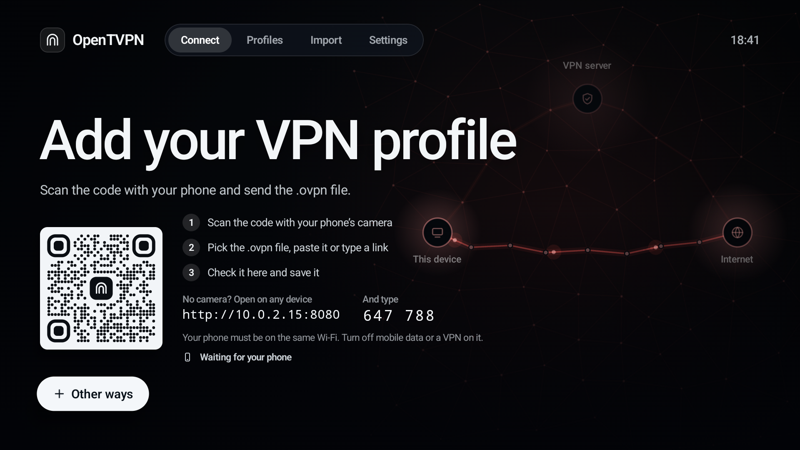

# OpenTVPN

OpenTVPN is a VPN app for Android TV and Google TV. It connects to your own OpenVPN or WireGuard server, and you use it with the TV remote.

Most VPN apps are made for phones and are awkward on a TV. This one is laid out for the big screen, and you don't type profiles in with the remote: you send the file from your phone.


## What it does

- Connects with OpenVPN (`.ovpn` files) and WireGuard (`.conf` files).
- Adds a profile from your phone. Scan the code on the TV, then pick the file, paste it or type a link on the phone. A USB drive or an HTTPS link works too.
- Shows where your traffic goes: green through the VPN, red straight to the internet.
- Has a kill switch, and blocks IPv6 and DNS outside the tunnel.
- Lets some apps skip the VPN, for streaming services that block VPNs, or sends only the apps you pick through it.
- Runs a speed test through the VPN and says whether it is fast enough for 4K.
- Pauses for 15 minutes, connects when the TV starts, and reconnects after a Wi-Fi change.
- Works as a control panel in your phone's browser once you pair the phone.
- Backs up every profile and setting to your phone, with a password you type for that backup, or none.
- Updates itself from this repository's releases.
- Has a PIN lock, and intents for home automation apps and ADB.

## Screenshots

| | |
|---|---|
|  |  |
| The first run asks for a profile from your phone | Import: a profile, a backup or a certificate |
|  |  |
| Profiles | A profile's settings |
|  |  |
| Speed test | Connection details |
|  | |
| Apps that skip the VPN | |

The screenshots are from the Android TV emulator. The profiles, servers and addresses in them are made up. The speed test measured the emulator's own connection.

## Install

You need Android TV or Google TV on Android 9 or newer, on an ARM chip.

Download an APK from [Releases](https://github.com/kanin-design/GoogleTV-VPN/releases) and sideload it, with `adb install` or a downloader app on the TV:

```
adb install opentvpn-0.2.5-alpha-arm64.apk
```

Use the `arm64` APK for 64-bit Android, such as the NVIDIA Shield, and `armv7` for 32-bit Android, such as the Chromecast with Google TV. If you are not sure, `adb shell getprop ro.product.cpu.abi` prints `arm64-v8a` or `armeabi-v7a`.

After that, new builds install from the app, in Settings › About.

This is an alpha. Builds up to 127 were signed with a development key, and Android won't install a newer build over one of them. To move, uninstall the old app and install the new one. Uninstalling deletes the profiles, so keep your profile files, or make a backup first and check that you know its password.

## Build

You need JDK 17, the Android SDK with platform 34, and NDK 26.1.10909125.

```
git clone --recursive https://github.com/kanin-design/GoogleTV-VPN.git
cd GoogleTV-VPN
```

The libraries are submodules in `third_party/`. Build OpenSSL once, as [third_party/OPENSSL-BUILD.md](third_party/OPENSSL-BUILD.md) describes, then:

```
JAVA_HOME=/path/to/jdk-17 ./gradlew assembleRelease
```

The APKs end up in `app/build/outputs/apk/release/`. They are signed with the project's release key if the machine has it (`~/Keys/OpenTVPN/opentvpn-release.p12`, or `-PreleaseKeystore=path`), and with your debug key if not. The key is never in the repository.

A build's number is 100 plus the commits on its branch. The app compares it to find updates. `tools/release.sh v0.2.5-alpha` builds both APKs from a clean checkout, checks the signature, writes `update.json` and uploads all three to that GitHub release.

The app's name is `appName` in `gradle.properties`.

## How it works

- OpenVPN uses the [OpenVPN 3](https://github.com/OpenVPN/openvpn3) core with OpenSSL 3.5, through JNI (`app/src/main/cpp`).
- WireGuard uses [wireguard-go](https://git.zx2c4.com/wireguard-go/), from WireGuard's Android library, without its GPL tools.
- The VPN runs in its own small process (`:vpn`), so the screens can close while you watch.
- The screens are Jetpack Compose without the Material library, drawn at the TV's full resolution.
- The phone panel and its encryption are in `remote/`. Everything it sends is encrypted with a key only the TV and that phone have.
- [docs/use-cases.md](docs/use-cases.md) has the behaviour in detail, with test notes.

## Privacy

Your profiles and settings stay in the app's private storage. Saved passwords are encrypted with a key in the device's keystore, and the PIN is stored as a salted hash.

What leaves the device:

- The VPN traffic, to the servers in your profiles.
- While connected, one request through the tunnel to api.ipify.org (or icanhazip.com), to show the address websites see.
- Files sent between the TV and your phone, and what a paired phone's panel sends and receives. This stays on your home network and is encrypted, but the pages themselves load over plain HTTP, because a TV can't have a certificate for a home address.
- A speed test, when you start one, to speed.cloudflare.com.
- Each time the app opens, a check of this repository's releases on api.github.com, unless you turn it off in Settings › About.

There are no accounts, analytics or ads.

## Third-party software

OpenVPN 3 core (MPL 2.0), OpenSSL (Apache 2.0), wireguard-go (MIT) and WireGuard's Android tunnel library (Apache 2.0), asio (Boost Software License 1.0), fmt (MIT), LZ4 and xxHash (BSD 2-Clause), ZXing (Apache 2.0), noble-ciphers and noble-hashes (MIT), Material Symbols (Apache 2.0), and Jetpack Compose and AndroidX (Apache 2.0). The full texts are in [app/src/main/assets/licenses.txt](app/src/main/assets/licenses.txt) and in the app under Settings › About.
