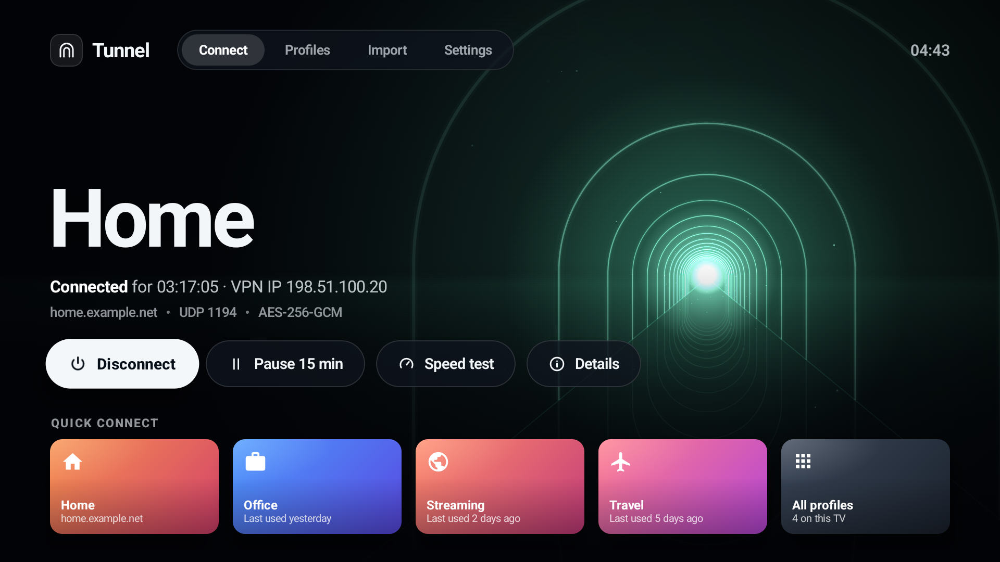
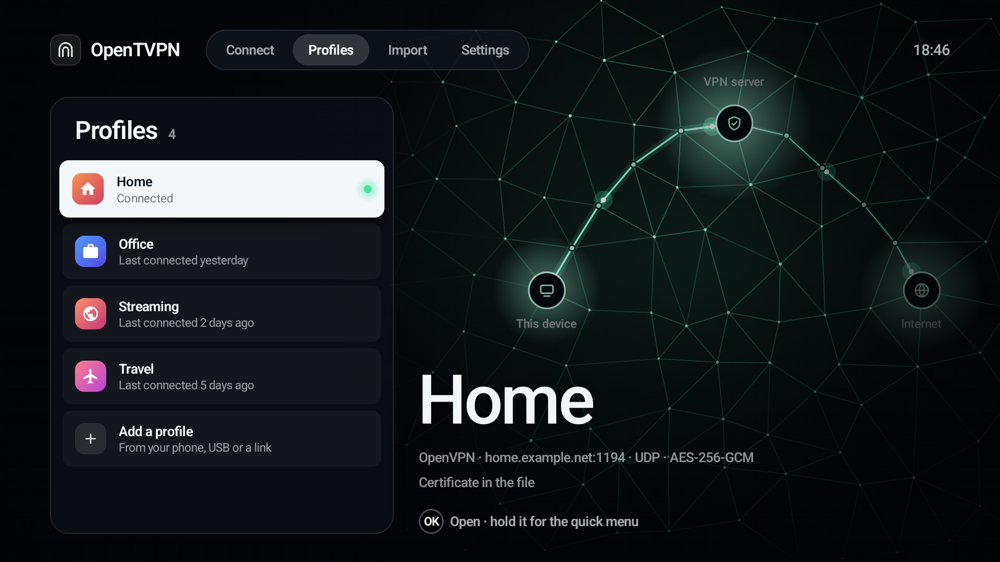
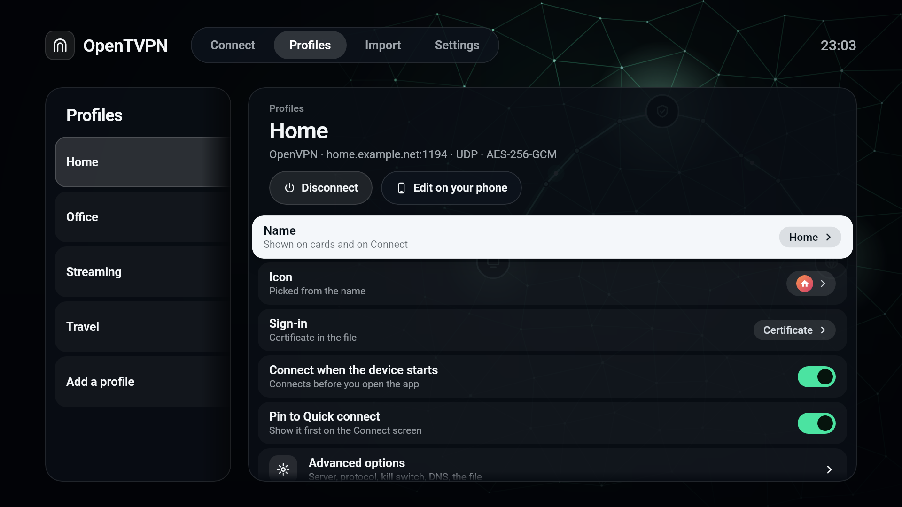
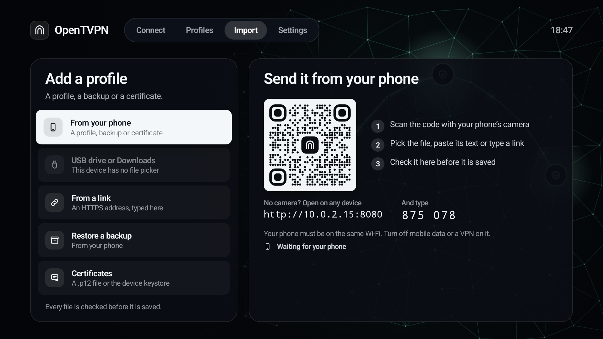
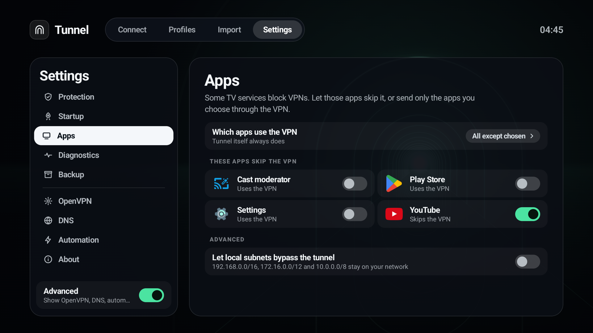
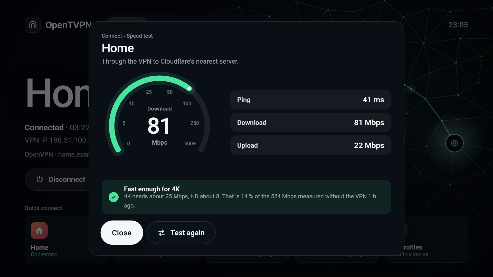
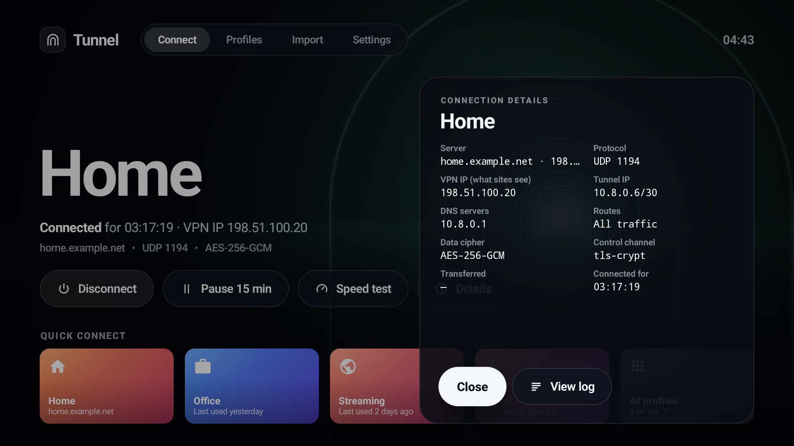

# OpenTVPN

An OpenVPN and WireGuard client for Android TV and Google TV, made for the remote. (It was called "OpenVPN client", and before that "Tunnel".)




## What it does

- **Connects with one press.** Connect shows the current profile, large, with the button you most likely want already focused. Quick connect cards below switch profiles. The background shows where your traffic goes: green from this device through your VPN to the internet while connected, yellow while it connects, and red straight to the internet when off.
- **OpenVPN and WireGuard, side by side.** A profile is either, by what its file says, and Connect names which in the line with its server. The kill switch, leak blocking, per-app routing, pause and reconnect work the same for both.
- **Imports profiles without typing.** Scan a QR code with your phone and pick or paste the `.ovpn` or `.conf` file there (a profile that asks for a username and password asks for them on the phone too, and they arrive with it), send a photo of a WireGuard QR code or a `.zip`, or use a USB drive, Downloads or an HTTPS link. The app works out what arrived: a profile, a backup or a certificate, and which profile a certificate belongs to. A file for a server that is here already offers to update that profile. Every file is checked before it is saved, and a login or key inside it is moved out and encrypted. What the phone's page sends and gets is encrypted between it and the TV.
- **Client certificates.** A `.p12` or `.pfx` file goes into the profile, or into Android's keystore, where the key can sign in but can't be copied off the device. A certificate already installed on the device works too.
- **Protection.** A kill switch, IPv6 and DNS leak blocking, and the choice to keep casting and devices at home reachable.
- **Per-app routing.** Let streaming services that block VPNs skip it, or send only the apps you choose through it.
- **Speed test.** Ping, download and upload through the VPN, on a speedometer, with whether it is fast enough for 4K or HD and how much of your plain connection the VPN keeps.
- **Everyday controls.** Pause for 15 minutes, connect when the device starts, and reconnect by itself after Wi-Fi changes. There are a connection test, a connection log and connection details.
- **A control panel on your phone.** Pair a phone once from a QR code, and its browser shows the whole app: status and Connect, every profile and setting, import, backup and the log, also while you watch TV with the VPN on. Every change is previewed first, a tunnel setting can be applied and tested and is put back if the test fails, and anything risky waits for an OK on the remote. Requests are encrypted end to end with a key only the TV and that phone hold.
- **Backups.** One file moves every profile, saved password and setting to a new device through your phone, encrypted with your backup passphrase (PBKDF2 and AES-GCM), or, with Settings › Backup › Use a password off, as a plain file. A restore shows what it adds and changes before it does.
- **Updates.** Each time it opens, it looks on GitHub for a newer build, by build number, so a build republished under the same version counts too. Settings › About downloads the APK for the device, checks its SHA-256 and installs it; Android asks you to confirm. If the VPN was on, it connects again once the new build is in.
- **PIN lock** for settings or the whole app, and **automation intents** for home automation apps and ADB.
- **Remote, keyboard or mouse.** Everything works with the remote; a keyboard types into fields (Enter moves on, as Done does), and a mouse can click anything.
- **Light on the device.** The VPN runs in its own small process (about 15 MB with OpenVPN on the Android TV emulator). The screens close themselves when you press Back, or three minutes after Home, so the device gets that memory back while you watch; with a phone paired, the panel's server stays in a process of about 12 MB while the VPN is on.

## Screenshots

| | |
|---|---|
|  |  |
| Profiles, with the one in focus shown large | A profile: name, icon, sign-in, startup and more |
|  |  |
| Import: scan the code and send the file from your phone | Settings › Apps: which apps skip the VPN |
|  |  |
| Speed test through the VPN | Connection details |

The screenshots use demo profiles on the Android TV emulator. The speed test is a real run through a home OpenVPN server about 250 ms away.

## Install

Download the APK from [Releases](https://github.com/kanin-design/GoogleTV-VPN/releases) and sideload it: with `adb install`, or with a downloader app on the device.

```
adb install opentvpn-0.2.3-alpha-arm64.apk
```

It needs Android TV or Google TV on Android 9 or newer, on ARM. There is one APK for each kind of chip: `arm64` for 64-bit Android, such as the NVIDIA Shield, and `armv7` for 32-bit Android, which some Google TV devices run, the Chromecast with Google TV among them. If you are not sure, `adb shell getprop ro.product.cpu.abi` says which: `arm64-v8a` or `armeabi-v7a`.

Later builds install from the app, in Settings › About › Updates. The first time, Android asks you to allow the app to install apps.

This is an alpha. Builds from 128 on are signed with the project's release key. Builds up to 127 were signed with a development key, and Android won't put one key's build over the other's. To move from one of those, back up your profiles (Settings › Backup), uninstall the app, install the new build, then restore the backup. The app says the same when it finds such a build.

## Build

You need JDK 17, the Android SDK (platform 34) and the NDK 26.1.10909125.

```
git clone --recursive https://github.com/kanin-design/GoogleTV-VPN.git
cd GoogleTV-VPN
```

The libraries are submodules in `third_party/`, pinned to the commits the app is built with. OpenSSL is built once into `third_party/openssl-install`, as described in [third_party/OPENSSL-BUILD.md](third_party/OPENSSL-BUILD.md). Then:

```
JAVA_HOME=/path/to/jdk-17 ./gradlew assembleRelease
```

The APKs are `app-arm64-v8a-release.apk` and `app-armeabi-v7a-release.apk` in `app/build/outputs/apk/release/`. Release builds are shrunk with R8. They are signed with the release key if this machine has it: `~/Keys/OpenTVPN/opentvpn-release.p12` (or `-PreleaseKeystore=path`), with its password in `OPENTVPN_KEY_PASSWORD` or the macOS Keychain item "OpenTVPN release key". Otherwise they are signed with your debug key, and `tools/release.sh` won't publish them. The key and its password are never in the repository.

Each build is numbered 100 plus the commits on its branch (`git rev-list --count HEAD`). The number is the APKs' `versionCode`, Settings › About shows it, and the update check compares it. To publish a release, from a clean checkout:

```
tools/release.sh v0.2.3-alpha
```

It builds both APKs, checks they are signed with the release key, writes `update.json` (the version, build number, commit, the key's certificate, and each APK's name, size and SHA-256) and uploads all three to that GitHub release with `gh`. `--dry-run` builds without uploading. The app finds updates through `update.json`, so every release needs it.

To rename the app, change `appName` in `gradle.properties`. Every screen, the notification and the home-screen label read it.

The TV banner and the launcher icon are a placeholder, "VPN" on a teal gradient, drawn by `tools/banner.py` with a heavy wide face such as Archivo Expanded Black (SIL Open Font License):

```
python3 tools/banner.py Archivo-ExpandedBlack.ttf
```

## How it is built

- The [OpenVPN 3](https://github.com/OpenVPN/openvpn3) core in C++ with OpenSSL 3.5, through JNI (`app/src/main/cpp`).
- WireGuard through [wireguard-go](https://git.zx2c4.com/wireguard-go/) (`libwg-go.so` from WireGuard's Android library), called through a small JNI shim of its own; the library's GPL tools are not in the APK.
- One control layer under the screens (`control/`), used by the TV and the phone panel alike, and the panel's server and encryption in `remote/` (ChaCha20-Poly1305 and HKDF on both ends).
- Jetpack Compose on Compose's foundation only, without the Material library.
- Drawn at the screen's full resolution, never upscaled. Android TV gives every app a 1920 × 1080 window, even on a 4K TV, and the TV scales that to 4K, as it does the home screen and every other app. The app fills that window pixel for pixel, and a 4K window if a TV offers one. Its layout is measured in design units, 1280 × 720 of them to the screen, but units aren't pixels: 1.5 pixels a unit at 1080p, 3 at 4K.
- The VPN service runs in its own process (`:vpn`) and tells the screens about the tunnel over a Binder (`vpn/VpnLink.kt`).
- [docs/use-cases.md](docs/use-cases.md) has the behaviour, test notes and measurements of memory and CPU.

## Privacy

What stays on the device: your profiles and settings, in the app's private storage. Saved passwords and the backup passphrase are encrypted with a key in the device's keystore, and the PIN is kept as a salted hash. A saved password is only sent to the servers its profile's file trusts: a new file that trusts others (another CA) takes it off, and it is typed again.

What leaves the device:
- the VPN traffic itself, to the servers named in your profiles;
- while connected, one request through the tunnel to api.ipify.org (or icanhazip.com), to show the address sites see;
- files you send to or from your phone, and what a paired phone's panel sends and receives, which stay on your home network, encrypted: the panel's with a key only the TV and that phone hold, the code pages' with a key the page and the TV agree when it opens. The pages themselves come over plain HTTP, as a TV can't have a certificate for a home address, so someone who can change traffic on your network (not only listen) could change a page;
- a speed test, only when you start one: data to and from speed.cloudflare.com;
- each time the app opens, unless you turn it off in Settings › About: a look at this app's releases on GitHub (api.github.com) for a newer build, and the build itself when you choose to install it.

No accounts, no analytics, no ads.

## Third-party software

OpenVPN 3 core (MPL 2.0), OpenSSL (Apache 2.0), wireguard-go (MIT) and WireGuard's Android tunnel library (Apache 2.0), asio (Boost Software License 1.0), fmt (MIT), LZ4 and xxHash (BSD 2-Clause), ZXing (Apache 2.0), noble-ciphers and noble-hashes (MIT), Material Symbols (Apache 2.0), and Jetpack Compose and AndroidX (Apache 2.0). The full texts are in [app/src/main/assets/licenses.txt](app/src/main/assets/licenses.txt), and in the app under Settings › About.
